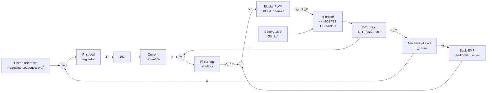
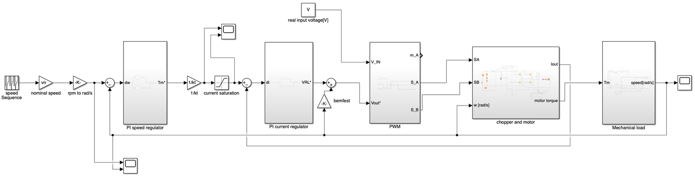
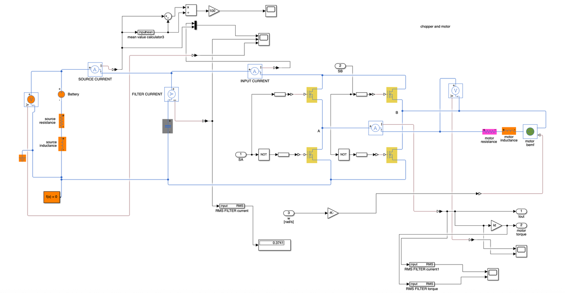
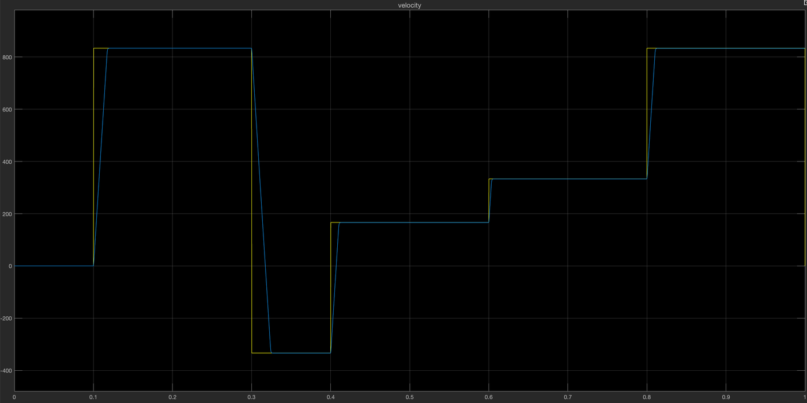
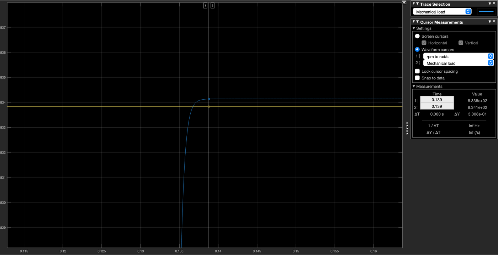
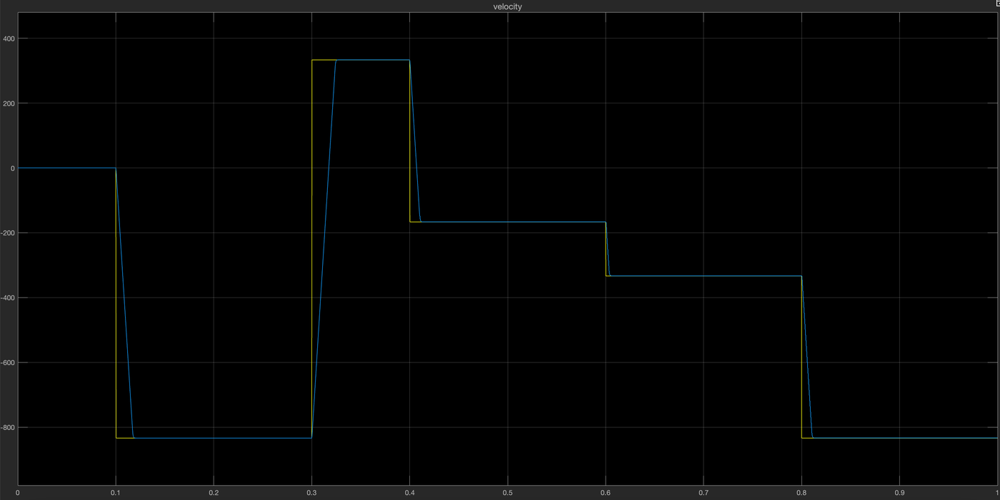
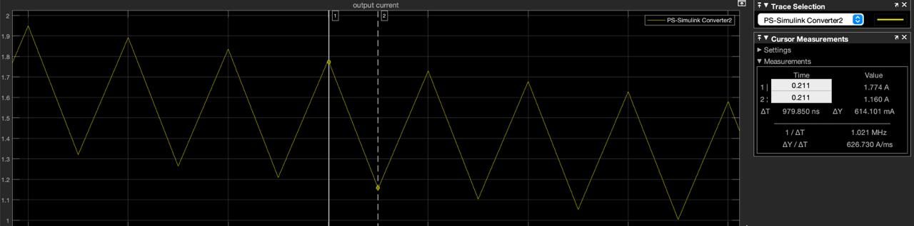
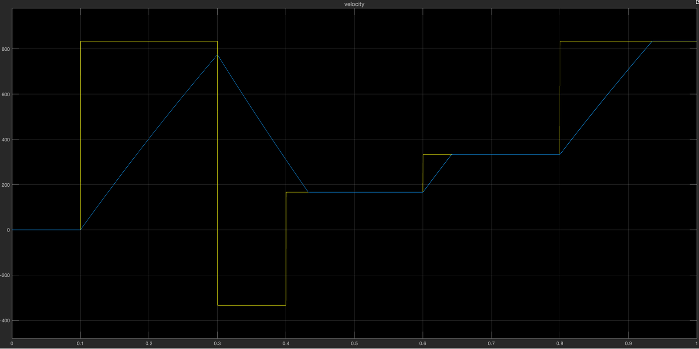

# Four-Quadrant DC Chopper Drive in Simscape

Simscape Electrical model of a **battery-fed brushed DC motor driven by a four-quadrant H-bridge chopper**, with cascaded speed/current PI control and PWM switching at 100 kHz.
The speed reference profile reverses direction and decelerates actively, so the drive runs in **all four quadrants**: forward and reverse motoring, plus forward and reverse regenerative braking.

## Architecture



| Subsystem | Implementation |
|---|---|
| **Power stage** | Four ideal switching MOSFETs in H-bridge (Simscape Electrical), 940 µF DC-link capacitor, battery with internal R and L |
| **Motor** | Armature resistance and inductance plus a controlled voltage source for the back-EMF; torque = kt·I |
| **Load** | Inertia J = J<sub>rotor</sub> + J<sub>load</sub>, load torque proportional to speed |
| **PWM** | Triangular carrier at f<sub>sw</sub> = 100 kHz. The duty is normalized by the measured supply voltage, and S<sub>B</sub> = ¬S<sub>A</sub> (bipolar modulation) |
| **Control** | Cascaded PI loops (speed → torque/current) with current saturation and back-EMF feedforward |
| **Measurements** | Sliding-window RMS and mean-value blocks for motor current, source current and torque |

### Simscape implementation

Top-level drive scheme:



Power stage and motor. The battery with its internal R and L, the DC-link capacitor, the four ideal MOSFETs of the H-bridge, the motor R-L-EMF branch and the current and voltage sensors are all physical Simscape components:



## Speed reference

The reference is a 1 s repeating sequence expressed in per-unit of the nominal speed (6370 rpm):

| Time (s) | 0–0.1 | 0.1–0.3 | 0.3–0.4 | 0.4–0.6 | 0.6–0.8 | 0.8–1.0 |
|---|---|---|---|---|---|---|
| Speed (p.u.) | 0 | 1.25 | −0.5 | 0.25 | 0.5 | 1.25 |

The step from +1.25 to −0.5 p.u. forces regenerative braking followed by reverse motoring. The smaller steps test regulation at partial speed.

## Results

Speed reference (yellow) vs. measured speed (blue, rad/s) over the full profile:



| Requirement | Target | Achieved |
|---|---|---|
| Output current ripple I<sub>pk-pk</sub> / I<sub>nom</sub> (steady state) | < 10% | ≈ 10% (0.6 A on 6 A) |
| Input (source) current ripple I<sub>pk-pk</sub> / I<sub>source,mean</sub> | < 1% | ≪ 1%, apart from isolated switching spikes |
| Speed range of stable operation | ±125% of nominal | ±125%, tested with two step profiles |
| Speed overshoot on step references | < 1% | 0% |
| Rise time on step references | < 100 ms | 37 ms (worst case) |
| Steady-state speed error | < 1% | 0% |

| Step response (zoom) | Reversed profile (−125%) |
|---|---|
|  |  |

Output current ripple at 100 kHz switching. Because the winding inductance is only 25 µH, the ripple is set by the inductance and the switching period, not by the controller tuning:



### Design note: current limit

With the current saturation set to the converter limit I<sub>max</sub> = 9 A, the motor stays in current saturation for the whole cycle and never reaches the reference. This is expected for a motor with a 102 A starting current that runs above 6000 rpm. The plot below shows the speed ramping at constant current instead of tracking the steps:



So that the speed loop can be designed and evaluated, the current saturation was raised to the starting current I<sub>s</sub> = 102 A. All results above use this limit.

> The results above were obtained with speed PI K<sub>p</sub> = 0.07, K<sub>i</sub> = 0.003 and current PI K<sub>p</sub> = 2000, K<sub>i</sub> = 500. `parameters.m` currently ships with a different gain set (see the table below). Change `Rp`, `Ri`, `Rpi` and `Rii` to reproduce these plots exactly.

## Motor and drive data

| Parameter | Value |
|---|---|
| Nominal voltage / speed / torque | 12 V / 6370 rpm / 0.095 N·m |
| Winding R / L | 0.12 Ω / 25 µH |
| Torque constant k<sub>t</sub> | 0.0164 N·m/A |
| Rotor + load inertia | 1.39·10⁻⁵ + 2.09·10⁻⁵ kg·m² |
| Supply | 15 V battery, R<sub>v</sub> = 0.15 Ω, L<sub>v</sub> = 150 µH |
| Switching frequency | 100 kHz |
| Speed PI (K<sub>p</sub>, K<sub>i</sub>) in `parameters.m` | 0.02, 0.1 |
| Current PI (K<sub>p</sub>, K<sub>i</sub>) in `parameters.m` | 50, 1000 |
| Current saturation | ±I<sub>s</sub> (see design note) |

All values are defined in [`parameters.m`](parameters.m) and can be changed there.

## How to run

Requirements: **MATLAB/Simulink R2024b** (or newer) with **Simscape** and **Simscape Electrical**.

```matlab
parameters                       % load motor, supply, converter and controller data
open_system('four_quadrant_chopper')
sim('four_quadrant_chopper')
```

The scopes at top level and inside the `chopper and motor` subsystem show the speed tracking, armature current, source current and motor torque.
Because of the 100 kHz switching, a full 1 s simulation takes a while. Shorten the stop time to explore single transients faster.

## Repository structure

```
four_quadrant_chopper.slx   Simulink/Simscape model
parameters.m                Motor, load, supply, converter and controller parameters
docs/img/                   Model screenshots and simulation results
```
